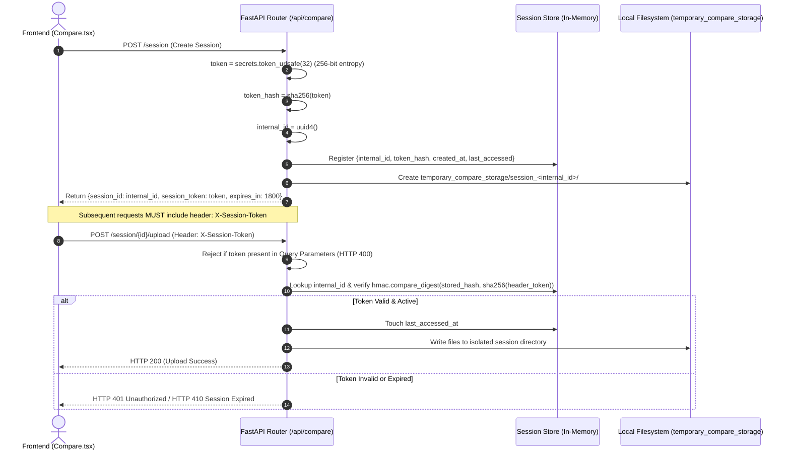
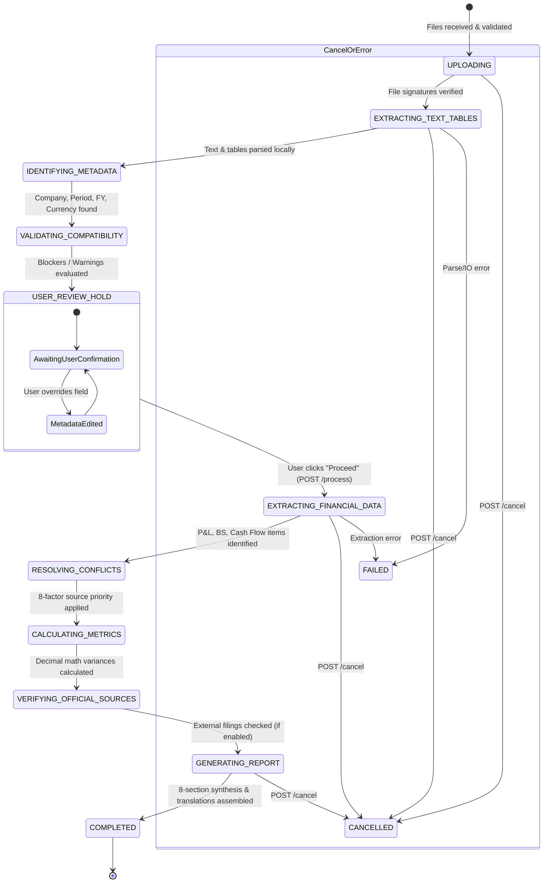

# Bharat Investor Copilot — Compare Documents
## Architectural Blueprint & System Design (Slice 0)

**Project:** Bharat Investor Copilot (SANGYAN 2026 Hackathon — IIT BHU)  
**File:** `docs/compare_documents_architecture.md`  
**Status:** Approved Specification (Slice 0 Deliverable)  
**Author:** Senior Software Architect, Backend Architect, Frontend Architect & Security Reviewer  

---

## 1. Executive Architecture Overview

The **Compare Documents** feature extends the Bharat Investor Copilot application to provide deep, evidence-grounded comparative financial understanding for Indian retail investors (such as our primary persona, Kavita). The system is built on the core principle of **"Understanding Before Action"** and operates strictly within SEBI-aligned non-advisory boundaries.

```
┌────────────────────────────────────────────────────────────────────────────────────────┐
│                               FRONTEND (React 19 + TypeScript)                         │
│                                                                                        │
│   [ Home.tsx ]  ────────►  [ Workspace.tsx (Single Doc) ] (UNTOUCHED)                 │
│         │                                                                              │
│         └───────────────►  [ Compare.tsx (Multi-Doc Compare) ] (NEW)                   │
│                                  │                                                     │
│            ┌─────────────────────┼─────────────────────┐                               │
│            ▼                     ▼                     ▼                               │
│     [ Dual/Multi Upload ]   [ Metadata & Compat ]   [ Results Dashboard ]              │
│     (Quick & Multi-Doc)     (Blockers & Warnings)   (Tables, SVG Charts, Evidence)     │
└──────────────────────────────────────────┬─────────────────────────────────────────────┘
                                           │ HTTP REST (Header: X-Session-Token)
                                           ▼
┌────────────────────────────────────────────────────────────────────────────────────────┐
│                              BACKEND (FastAPI on Python 3.13)                          │
│                                                                                        │
│   [ /api/documents/* ] (Existing Single-Doc Router - UNTOUCHED)                        │
│   [ /api/chat ]        (Existing Single-Doc Chat - UNTOUCHED)                          │
│   [ /api/compare/* ]   (Dedicated Compare Router - NEW)                                │
│                                                                                        │
│   Core Modular Services:                                                               │
│   ├── Session & Security: comparison_session_store.py (256-bit token + SHA256)         │
│   ├── File Ingestion:     pdf_inspector.py, docx_parser.py, spreadsheet_parser.py    │
│   ├── Metadata & Rules:   compare_identifier.py, compatibility_validator.py            │
│   ├── Conflict Engine:    conflict_detector.py (8-factor context-aware priority)       │
│   ├── Financial Math:     financial_calculator.py (decimal.Decimal deterministic)      │
│   ├── Synthesis & i18n:   compare_synthesizer.py, compare_translator.py (Trilingual)  │
│   └── Export Engines:     export_excel_service.py (7 tabs), browser CSS print / PDF    │
└────────────────────────────────────────────────────────────────────────────────────────┘
```

### Core Architecture Axioms
1. **Zero Impact on Existing Single-Doc Workflow:** [Workspace.tsx](file:///C:/Users/mayur/.gemini/antigravity/scratch/Sangyan_Hackathon_Fresh/app/src/pages/Workspace.tsx), [document_processor.py](file:///C:/Users/mayur/.gemini/antigravity/scratch/Sangyan_Hackathon_Fresh/backend/app/services/document_processor.py), and [chat_service.py](file:///C:/Users/mayur/.gemini/antigravity/scratch/Sangyan_Hackathon_Fresh/backend/app/services/chat_service.py) remain 100% intact. Compare is an isolated router and view.
2. **Deterministic Arithmetic:** Gemini never performs math. All additions, variances, and ratios use Python's `decimal.Decimal` with 4-place internal precision and 2-place display precision.
3. **Multi-Document Ingestion by Design:** Supports both **Quick Compare** (2 documents) and **Multi-Document Compare** (up to 5 documents initially, governed by `COMPARE_MAX_DOCUMENTS`), outputting both an $N \times M$ matrix and granular pairwise comparisons.
4. **Context-Aware Conflict Resolution:** Discrepancies resolve through an explainable 8-factor hierarchy. Ambiguous equal-priority candidates are marked `UNCERTAIN` for user inspection.
5. **Strict ₹0 Budget:** Zero paid cloud APIs, external paid OCR services, or subscriptions. All processing is local-first, with Gemini Free Tier leveraged exclusively for consented natural language synthesis and translation.

---

## 2. Comparison Session Lifecycle & Security Architecture

### Capability Token & Filesystem Isolation Architecture
The architecture strictly enforces capability-based security. No unauthenticated requests reach comparison state, and no session identifiers leak in URLs or server logs.



### Dual-Timeout Enforcement Architecture
The session lifecycle is bounded by two backend-enforced constraints:
1. **Inactivity Timeout (30 minutes):** Every incoming valid request updates `session.last_accessed_at = datetime.utcnow()`. If `now - last_accessed_at > 30 minutes`, the session is expired.
2. **Absolute Maximum Lifetime (4 hours):** Regardless of ongoing user activity, if `now - created_at > 4 hours`, the session reaches its hard expiration ceiling.

### Cleanup Schedulers & Triggers
- **Lazy Request Evaluation:** Every API call evaluates expiration before executing logic. Expired sessions trigger immediate background folder deletion and return HTTP 410.
- **Asynchronous Background Sweeper:** An `asyncio` task runs every 5 minutes (`asyncio.sleep(300)`), scanning the session store, identifying expired sessions, and unlinking their directory trees with `shutil.rmtree()`.
- **Explicit Deletion (`DELETE /session/{id}`):** Triggered when the user clicks "Start Over" or leaves the workspace.
- **Browser Beacon Teardown:** Frontend triggers `navigator.sendBeacon("/api/compare/session/{id}/cleanup")` on page unload.
- **Backend Startup Sweep:** On FastAPI startup (`lifespan` handler), the backend inspects `temporary_compare_storage/` and deletes any orphan directories remaining from previous process terminations.

---

## 3. Document Processing Pipeline Lifecycle

The comparison pipeline executes across nine discrete, measurable stages. In accordance with anti-fabrication rules, progress is reported via genuine state transitions without invented percentages or synthetic ETAs.



---

## 4. Multi-Layer Cancellation & Backend Recovery Architecture

To ensure operations do not linger in the background or consume unneeded resources, cancellation propagates across all synchronous and asynchronous boundaries:

```
┌────────────────────────────────────────────────────────────────────────────────────────┐
│                             MULTI-LAYER CANCELLATION MATRIX                            │
├──────────────────────┬──────────────────────────────────┬──────────────────────────────┤
│ Execution Layer      │ Cancellation Mechanism           │ Post-Cancellation Cleanup    │
├──────────────────────┼──────────────────────────────────┼──────────────────────────────┤
│ Async Coroutines     │ asyncio.Task.cancel()            │ Catches asyncio.CancelledError│
│                      │                                  │ releases locks, drops queue  │
├──────────────────────┼──────────────────────────────────┼──────────────────────────────┤
│ Thread-Pool Tasks    │ Cooperative threading.Event flag │ Checks cancel_event.is_set() │
│ (run_in_executor)    │ checked between pages/sheets     │ terminates loop gracefully   │
├──────────────────────┼──────────────────────────────────┼──────────────────────────────┤
│ PyMuPDF / Parsers    │ Checks session.is_cancelled      │ Closes fitz.Document handles │
│                      │ on each page iteration           │ unlinks temp extraction JSON │
├──────────────────────┼──────────────────────────────────┼──────────────────────────────┤
│ Gemini API HTTP      │ In-flight httpx client closed;   │ Socket disconnected; response│
│ Calls                │ task cancelled via async client  │ discarded before parsing     │
├──────────────────────┼──────────────────────────────────┼──────────────────────────────┤
│ Subprocesses         │ process.terminate() ->           │ Subprocess tree killed;      │
│ (OCR / CLI tools)    │ process.kill() if not exited     │ stdout/stderr pipes closed   │
├──────────────────────┼──────────────────────────────────┼──────────────────────────────┤
│ Export Generation    │ Checked between Excel sheets     │ Partial .xlsx/.pdf unlinked; │
│                      │ and PDF report pages             │ memory buffers dereferenced  │
└──────────────────────┴──────────────────────────────────┴──────────────────────────────┘
```

### Incomplete vs Completed State Guarantees
- A session can never transition to `COMPLETED` if any active extraction or calculation step was aborted.
- If processing is cancelled or fails, the database records status `CANCELLED` or `FAILED` along with the exact stage and error message.
- Frontend refresh queries `GET /session/{id}/status`. If the backend was cancelled or failed, the frontend displays the failure reason and provides a "Retry" or "Start Over" button without crashing.

---

## 5. Privacy, AI Consent & Processing Boundaries

The platform guarantees strict privacy-by-design through two completely segregated processing modes:

### Local Mode (Default if Consent Withheld)
- **Local Extraction:** PyMuPDF extracts digital text and tables; OpenXML extracts DOCX tables; openpyxl extracts XLSX.
- **Local Financial Math:** Variances, percentage changes, and ratios computed purely via Python's `decimal.Decimal`.
- **Local Comparison Tables:** Side-by-side matrices rendered directly from extracted numbers.
- **Local SVG Charts:** Responsive bar, column, and line charts generated client-side with native SVG.
- **Zero Cloud Invocations:** Under no circumstances are file bytes or extracted text transmitted to external networks.
- **Scanned Document Handling:** If scanned pages are uploaded without local Tesseract installed, the system flags `OCR_UNAVAILABLE_LOCAL_MODE` and renders page crops for visual reading without erroring out.

### AI-Assisted Mode (Requires Explicit Consent)
- **Consent Gate:** Enabled only when the user checks the neutral consent box:
  > *"I agree to AI-assisted document processing for automated summarization, comparative narrative synthesis, and multilingual translation."* (Model name intentionally omitted).
- **Capabilities Unlocked:**
  1. Multimodal OCR for scanned tables and image filings (via Gemini Vision).
  2. Grounded 8-section comparative synthesis.
  3. Trilingual translation across English, Hindi, and Hinglish.
  4. Comparative Q&A chat.
- **Consent Revocation (`DELETE /session/{id}/consent`):**
  - Immediately toggles session state to `consent_granted = False`.
  - Aborts any currently executing Gemini API requests.
  - Flushes all cached AI narrative summaries from session memory.
  - Reverts the dashboard to Local Mode, preserving completed local tables, calculations, and SVG charts.
  - User is informed that previously transmitted requests cannot be recalled from external server logs.

---

## 6. Context-Aware Financial Conflict Resolution Architecture

Universal hierarchy rules (such as ranking Consolidated statements above Standalone statements) fail in real-world Indian filings where holding companies and operating subsidiaries report under different statutory obligations. The conflict resolution engine applies eight distinct contextual rules:

```
┌────────────────────────────────────────────────────────────────────────────────────────┐
│                   8-FACTOR CONTEXT-AWARE CONFLICT RESOLUTION MATRIX                    │
├────┬─────────────────────────────┬─────────────────────────────────────────────────────┤
│ 1  │ Reporting Entity Alignment  │ Consolidated compares to Consolidated; Standalone   │
│    │                             │ to Standalone. Cross-scope triggers WARNING badge.  │
├────┼─────────────────────────────┼─────────────────────────────────────────────────────┤
│ 2  │ Reporting Period Alignment  │ Exact calendar/period match (FY24 vs FY23). Disclose│
│    │                             │ 9-month vs quarterly duration discrepancies.        │
├────┼─────────────────────────────┼─────────────────────────────────────────────────────┤
│ 3  │ Audit Status Authority      │ Audited (Statutory Auditor signed) > Unaudited /    │
│    │                             │ Provisional / Management Investor Presentations.    │
├────┼─────────────────────────────┼─────────────────────────────────────────────────────┤
│ 4  │ Restatement Supersession    │ Later period comparative restatement > Earlier      │
│    │                             │ original historical disclosure for same prior period│
├────┼─────────────────────────────┼─────────────────────────────────────────────────────┤
│ 5  │ Metric Definition Precedence│ Statutory Ind AS / GAAP line item > Non-GAAP /      │
│    │                             │ Adjusted / Operational custom definitions.          │
├────┼─────────────────────────────┼─────────────────────────────────────────────────────┤
│ 6  │ Statement Tier Authority    │ Primary Tables (Balance Sheet, P&L, Cash Flow) >    │
│    │                             │ Notes to Accounts Schedules > MD&A Narrative.       │
├────┼─────────────────────────────┼─────────────────────────────────────────────────────┤
│ 7  │ Evidence Format Quality     │ Machine-readable digital table cell > Paragraph text│
│    │                             │ > Low-confidence scanned OCR string.                │
├────┼─────────────────────────────┼─────────────────────────────────────────────────────┤
│ 8  │ Ambiguity & UNCERTAIN Rule  │ If conflicting candidates share identical priority, │
│    │                             │ mark UNCERTAIN. Explain conflict; never let LLM pick│
└────┴─────────────────────────────┴─────────────────────────────────────────────────────┘
```

---

## 7. Evidence Provenance & Highlighting Flow

Every piece of comparative data displayed to the user maintains an unbreakable chain of custody back to the original document:
1. **Extraction Tagging:** When text or numbers are extracted, the parser tags the item with an `EvidenceReference`:
   - `doc_id`: Unique identifier of the uploaded document.
   - `file_type`: Format (`PDF`, `DOCX`, `XLSX`).
   - `page_number`: 1-based physical page index (for PDF).
   - `bounding_box`: Normalised `[x0, y0, x1, y1]` coordinates (for PDF/images).
   - `structural_reference`: Section, heading, table row/column (for DOCX/XLSX).
   - `verbatim_snippet`: Exact 20–100 word excerpt surrounding the figure.
2. **On-Demand Page Rasterization (`GET /session/{id}/evidence/{doc_id}/page/{num}`):**
   - The backend uses PyMuPDF (`page.get_pixmap(dpi=150)`) to render the exact page as a PNG stream.
   - Memory is freed immediately after streaming; pages are **not** pre-rendered in bulk.
3. **Frontend Evidence Modal (`CompareEvidenceModal.tsx`):**
   - Renders side-by-side document pages with highlighted bounding boxes over the cited evidence snippet.
   - For DOCX/XLSX, displays the structural coordinates and exact surrounding text excerpt.

---

## 8. Export Architecture (Excel & PDF)

### Multi-Tab Excel Workbook (`openpyxl`)
- Created using `openpyxl.Workbook()`.
- Built purely in memory using `io.BytesIO()` and streamed to client.
- Strictly adheres to the seven approved worksheets:
  1. `Executive Summary`: High-level findings, metadata, disclaimers.
  2. `Financial Metrics`: Normalized multi-column matrix with units.
  3. `Calculations`: Absolute variances, percentage changes, math formulas.
  4. `Risks & Disclosures`: Disclosed risk factors with page references.
  5. `Accounting Differences`: Standards, policies, audit qualifications.
  6. `Source Evidence`: Exhaustive log of all citations, excerpts, and pages.
  7. `Verification Results`: Official registry status and checks.
- Zero macro execution; all cells contain static formatted values and standard formulas.

### High-Fidelity PDF Export (Browser CSS Print + PyMuPDF)
- **Primary Method:** Client-Side CSS Paged Media (`@media print` stylesheet). Renders responsive vector tables, Devanagari Hindi text, and SVG charts via the browser's PDF engine with zero backend server RAM usage.
- **Headless Fallback:** Secondary headless export using PyMuPDF native document builder (`fitz.open()`) assembling summary tables and footnotes for automated CLI/API downloads.
